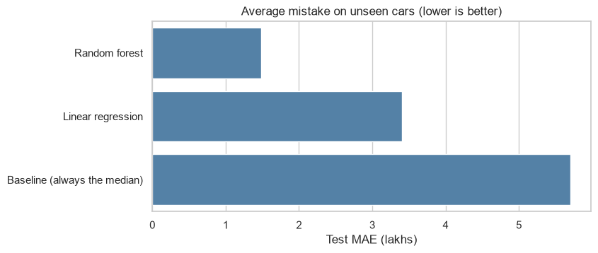
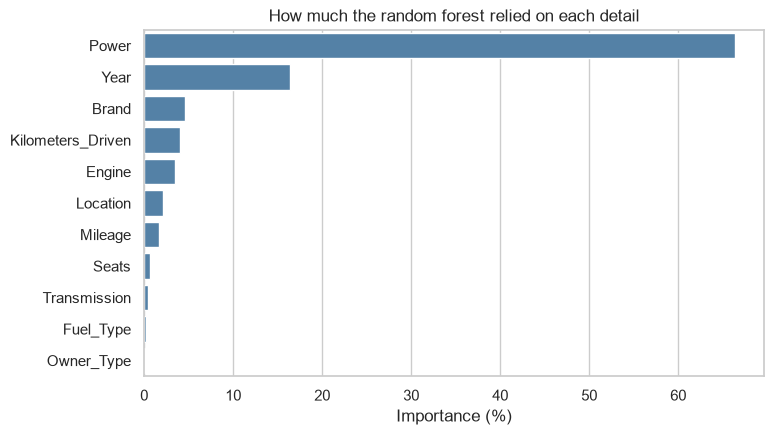

# Data Science Projects

A set of beginner-to-intermediate data projects built with Python, based on a dataset of used car prices in India.

| # | Project | Status |
|---|---|---|
| 1 | [Exploratory data analysis](#project-1-used-car-prices-exploratory-data-analysis) | Done |
| 2 | [Price predictor (machine learning)](#project-2-used-car-price-predictor) | Done |
| 3 | Interactive dashboard (Streamlit) | Planned |

---

## Project 1: Used Car Prices, Exploratory Data Analysis

**Question:** what affects the resale price of a used car in India?

I cleaned a real dataset of 5,847 used car listings and explored it with charts to find out which factors matter most. The full analysis is in [notebooks/01_eda.ipynb](notebooks/01_eda.ipynb).

### Dataset
- Kaggle, [*Used Car Prices*](https://www.kaggle.com/datasets/sujay1844/used-car-prices) by Sujay R, originally sourced from Cars24 (Apache 2.0 license).
- 5,847 cars, 14 columns: name, city, year, kilometers driven, fuel type, transmission, owner type, mileage, engine size, power, seats, new price and resale price.
- `Price` is in lakhs of rupees.

### What I did
1. **Inspected the data** for wrong types, missing values and unrealistic numbers.
2. **Cleaned it:**
   - dropped `New_Price` (86% missing) and a row-counter column
   - converted Mileage, Engine and Power from text (e.g. `"19.67 kmpl"`) to numbers
   - extracted a `Brand` column from the car name, fixing "Land Rover" and "BMW"
   - removed 40 rows with missing values
   - removed 1 impossible row (a 2017 BMW X5 listed with 6,500,000 km)
3. **Explored** price against year, fuel type, brand, kilometers and city.
4. **Saved** the cleaned data as `data/cars_clean.csv` (5,806 cars) for the next projects.

### Key findings
- **Most cars are cheap.** The median price is 5.75 lakhs, but the mean is 9.7 because of a few luxury cars. 74% of cars cost under 10 lakhs.
- **Age is a strong price signal.** Median price rises from about 1 lakh for cars from the early 2000s to about 11.5 lakhs for 2019 cars.
- **Brand matters a lot.** Land Rover (35 lakhs median), Jaguar, Mercedes-Benz, Audi and BMW are the most expensive. Chevrolet, Fiat and Tata are the cheapest.
- **Diesel cars cost more than petrol** (7.8 vs 4.3 lakhs median), but diesel cars here also have bigger engines, so fuel type alone does not explain the gap.
- **Kilometers driven and city matter less.** The correlation between kilometers and price is only -0.16.


### Limitations
- Data comes from one source and covers cars up to 2019, so it may not reflect today's market.
- The charts show links between variables, not causes. Year, brand and engine size change together.

---

## Project 2: Used Car Price Predictor

**Question:** can a model predict a used car's price from its details?

Using the cleaned data from Project 1, I trained and compared machine learning models. The full work is in [notebooks/02_price_model.ipynb](notebooks/02_price_model.ipynb).

### What I did
1. **Split the data:** 4,644 cars for training and 1,162 hidden for testing, so scores are measured on cars the model has never seen.
2. **Set a baseline:** always guessing the median price, which is off by 5.70 lakhs on average.
3. **Prepared the features:** one-hot encoded the text columns (brand, fuel type, transmission, owner type, city), giving 53 input columns.
4. **Trained two models** in a scikit-learn pipeline: linear regression and a random forest of 200 trees.
5. **Compared them** on the hidden test cars using MAE (average mistake, in lakhs) and R².
6. **Checked which features matter most** and tried the model on real cars.

### Results (on 1,162 unseen cars)

| Model | Average mistake (MAE) | R² |
|---|---|---|
| Baseline (always the median) | 5.70 lakhs | -0.11 |
| Linear regression | 3.41 lakhs | 0.72 |
| **Random forest** | **1.48 lakhs** | **0.86** |



### Key findings
- **The random forest is about four times more accurate than the baseline.**
- **Linear regression predicted negative prices** for 128 of 1,162 test cars, because a straight line cannot capture how prices behave.
- **The forest overfits a little:** it is off by 0.53 lakhs on training cars but 1.48 on test cars, which is why scoring on hidden data matters.
- **Power (66%) and Year (16%)** drive the predictions, which agrees with the exploration in Project 1. Brand scores low (4.5%) because it overlaps with power.
- **Cheaper cars are predicted more accurately** than expensive ones, since there are fewer luxury cars to learn from.



### Limitations
- Data from one source, up to 2019, so predictions may not match today's market.
- One train/test split and no tuning of model settings, so the score could be improved a little.
- Predictions for rare and expensive cars are less reliable.

---

## Project structure
```
data-projects/
├── data/
│   ├── train.csv          # original data from Kaggle (unchanged)
│   └── cars_clean.csv     # cleaned data
├── notebooks/
│   ├── 01_eda.ipynb       # Project 1: analysis
│   └── 02_price_model.ipynb   # Project 2: price predictor
├── images/                # charts used in this README
├── requirements.txt
└── README.md
```
The trained model (`models/price_model.joblib`, about 81 MB) is created when you run notebook 02. It is not stored in this repo because of its size.

## How to run it
```bash
python3 -m venv .venv
source .venv/bin/activate
pip install -r requirements.txt
jupyter notebook
```
Then open `notebooks/01_eda.ipynb` and `notebooks/02_price_model.ipynb`.

## Tools
Python, pandas, matplotlib, seaborn, scikit-learn, Jupyter.
