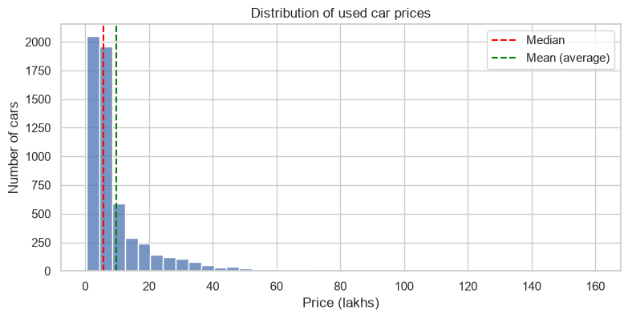
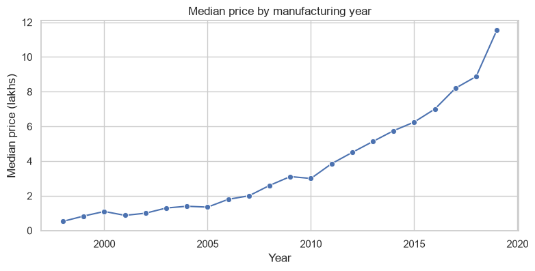
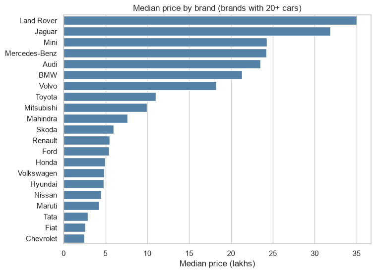

# Data Science Projects

A set of beginner-to-intermediate data projects built with Python, starting with an analysis of used car prices in India.

| # | Project | Status |
|---|---|---|
| 1 | [Used Car Prices: Exploratory Data Analysis](#project-1-used-car-prices-exploratory-data-analysis) | Done |
| 2 | Price predictor (machine learning) | Planned |
| 3 | Interactive dashboard (Streamlit) | Planned |

---

## Project 1: Used Car Prices, Exploratory Data Analysis

**Question:** what affects the resale price of a used car in India?

I cleaned a real dataset of 5,847 used car listings and explored it with charts to find out which factors matter most. The full analysis is in [notebooks/01_eda.ipynb](notebooks/01_eda.ipynb).

### Dataset
- Kaggle, [*Used Car Prices*](https://www.kaggle.com/datasets/sujay1844/used-car-prices) by Sujay R, originally sourced from Cars24 (Apache 2.0 license).
- 5,847 cars, 14 columns: name, city, year, kilometers driven, fuel type, transmission, owner type, mileage, engine size, power, seats, new price and resale price.
- `Price` is in lakhs of rupees.

### What I did
1. **Inspected the data** for wrong types, missing values and unrealistic numbers.
2. **Cleaned it:**
   - dropped `New_Price` (86% missing) and a row-counter column
   - converted Mileage, Engine and Power from text (e.g. `"19.67 kmpl"`) to numbers
   - extracted a `Brand` column from the car name, fixing "Land Rover" and "BMW"
   - removed 40 rows with missing values
   - removed 1 impossible row (a 2017 BMW X5 listed with 6,500,000 km)
3. **Explored** price against year, fuel type, brand, kilometers and city.
4. **Saved** the cleaned data as `data/cars_clean.csv` (5,806 cars) for the next projects.

### Key findings
- **Most cars are cheap.** The median price is 5.75 lakhs, but the mean is 9.7 because of a few luxury cars. 74% of cars cost under 10 lakhs.
- **Age is a strong price signal.** Median price rises from about 1 lakh for cars from the early 2000s to about 11.5 lakhs for 2019 cars.
- **Brand matters a lot.** Land Rover (35 lakhs median), Jaguar, Mercedes-Benz, Audi and BMW are the most expensive. Chevrolet, Fiat and Tata are the cheapest.
- **Diesel cars cost more than petrol** (7.8 vs 4.3 lakhs median), but diesel cars here also have bigger engines, so fuel type alone does not explain the gap.
- **Kilometers driven and city matter less.** The correlation between kilometers and price is only -0.16.





### Limitations
- Data comes from one source and covers cars up to 2019, so it may not reflect today's market.
- The charts show links between variables, not causes. Year, brand and engine size change together.

### Project structure
```
data-projects/
├── data/
│   ├── train.csv          # original data from Kaggle (unchanged)
│   └── cars_clean.csv     # cleaned data
├── notebooks/
│   └── 01_eda.ipynb       # the full analysis
├── images/                # charts used in this README
├── requirements.txt
└── README.md
```

### How to run it
```bash
python3 -m venv .venv
source .venv/bin/activate
pip install -r requirements.txt
jupyter notebook notebooks/01_eda.ipynb
```

### Tools
Python, pandas, matplotlib, seaborn, Jupyter.
